# HomestayManagementSystem
民宿管理系统 亮点：AI民宿总结、协同过滤推荐算法、WebSocket 在线咨询、ECharts 经营分析、房态与结算联动、 民宿预订业务闭环； 角色：用户、房东、管理员；

所有源码均本人开发，项目是前后端分离的，所有的项目都具备了完整的业务逻辑，不仅仅局限于基础的增删改查（CRUD）操作，系统亮点众多。

本文注重于计算机毕业设计选题指导，列出题目均有源码， 大家可以去【公众号】(毕业终点站)获取或者加我【qq】(2112698948)提意见(别忘记Star哟)。备注：git

声明：仅用于学习使用，请勿用于任何商业行为！

1.系统非商用，非开源，非无偿。

2.由本人开发，如需源码，请联系以下方式，qq:2112698948。

3.项目有很多，并未全部上传，如果未找到想要的，可直接咨询。

# 民宿管理系统

**Spring Boot 3 + Vue 3 前后端分离 · 住客前台 / 房东后台 / 平台管理后台**

智能推荐 · AI 民宿总结 · 在线咨询 · 经营分析 · 房态结算联动

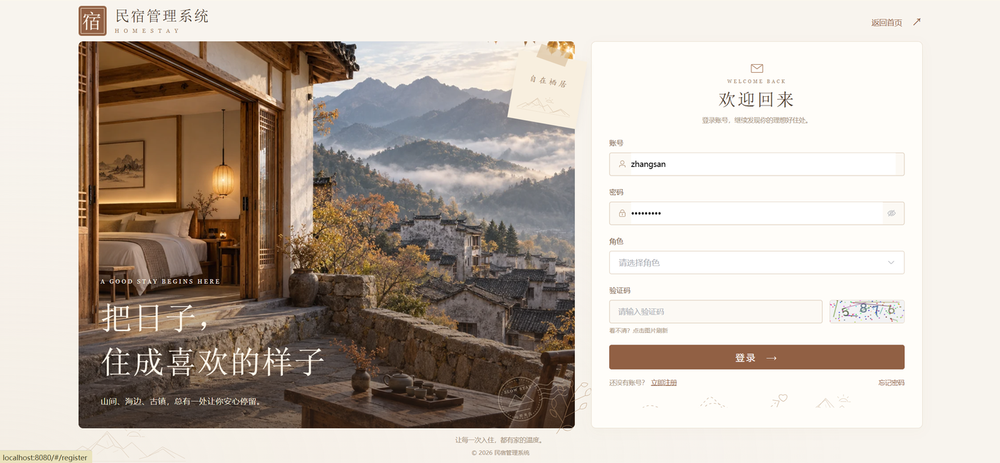

---

## 一、系统亮点

- 🎯 **协同过滤推荐算法**：根据民宿预订记录找出预订过当前民宿的其他用户，汇总他们预订过的其他房源，按预订次数筛选候选，排除当前民宿并过滤已下架房源；缺少共同预订用户或候选房源时，用其他民宿的最新上架房源兜底，帮住客发现可比较的住宿选择。
- 🏠 **民宿预订全流程**：串联房东入驻、房源发布、房态定价、住客预订、订单确认、入住退房、评价与退订处理，完整展示业务流程。
- 🤖 **AI 民宿总结**：后端接入 DeepSeek，结合民宿位置、房源设施、预订情况与住客评价生成中文推荐总结，支持缓存与手动刷新，帮住客快速了解民宿特点。
- 💬 **WebSocket 在线咨询**：住客与房东围绕具体民宿交流入住需求，支持会话列表、聊天记录和未读消息查看。
- 📊 **ECharts 经营分析**：管理员查看平台订单、营收、房源分类与民宿排行，房东查看自身营收、入住率和评价分布，为经营情况提供直观参考。
- 📅 **房态与结算联动**：房东按日期维护房价和可订状态，平台按订单营收、退款及抽成比例计算应结金额，前台预订和后台运营数据保持一致。

---

## 二、技术选型

| 分类 | 技术 |
| --- | --- |
| 系统架构 | B/S、MVC、前后端分离，住客前台、房东后台、平台管理后台 |
| 系统环境 | Windows |
| 开发环境 | IDEA、JDK 17、Maven、MySQL、Node.js |
| 后端技术 | Java、Spring Boot 3、Spring MVC、MyBatis-Plus、MySQL、JWT、WebSocket、DeepSeek API |
| 前端技术 | Vue 3、Vite、Element Plus、Vue Router、Pinia、Axios、ECharts、SCSS |

---

## 三、系统角色与功能

| 角色 | 主要功能 |
| --- | --- |
| 普通用户 | 注册登录与资料维护、首页浏览、民宿搜索与分类筛选、民宿详情与房源设施、房态日历、收藏房源、选择日期人数下单、订单支付演示与取消、申请退订与进度查询、入住后评分晒图、投诉与意见建议、平台公告、AI 民宿总结与推荐房源、在线咨询 |
| 房东 | 注册登录与入驻申请、民宿资料维护与地图选点、房源发布上下架、房型价格面积设施维护、房态日历按日期定价与批量设置、订单确认拒绝、入住退房办理、退订审核与退款处理、评价查看与回复、在线咨询、经营看板与房源营收统计 |
| 管理员 | 平台数据看板、房东入驻申请审核、房东信息维护与警告下架清退、用户账号与房源分类管理、轮播图与平台公告、平台经营统计与营业额排行、退款额统计、抽成计算与结算单管理、投诉与建议处理 |

---

## 四、系统实现（核心截图）

### 4.1 普通用户端

<table>
  <tr>
    <td width="50%" align="center"> <b>首页</b></td>
    <td width="50%" align="center"> <b>民宿列表</b></td>
  </tr>
  <tr>
    <td width="50%" align="center">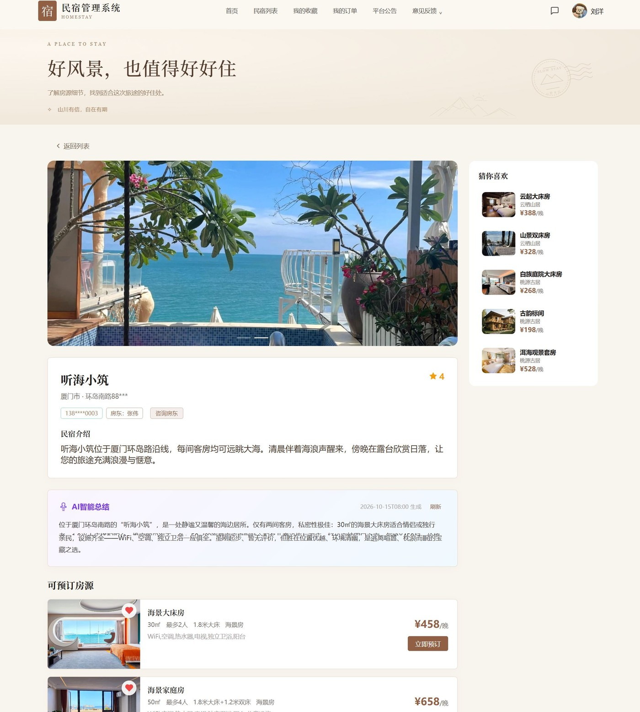 <b>民宿详情</b></td>
    <td width="50%" align="center">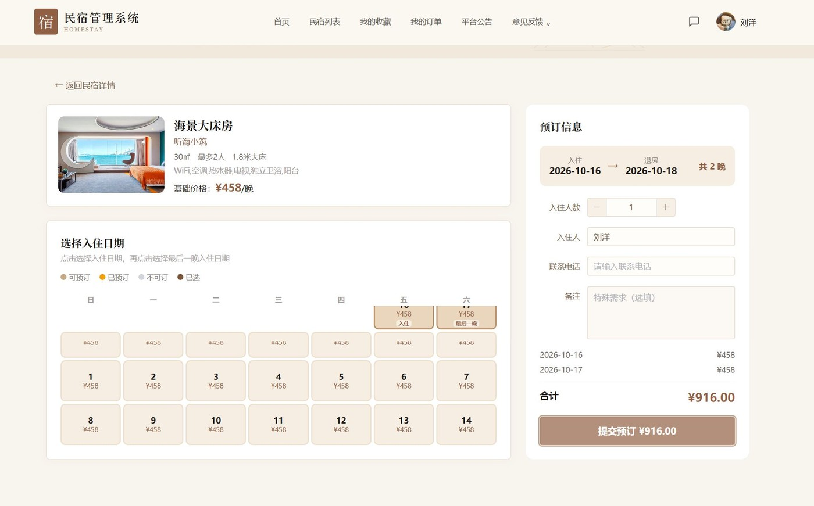 <b>预定民宿</b></td>
  </tr>
  <tr>
    <td width="50%" align="center">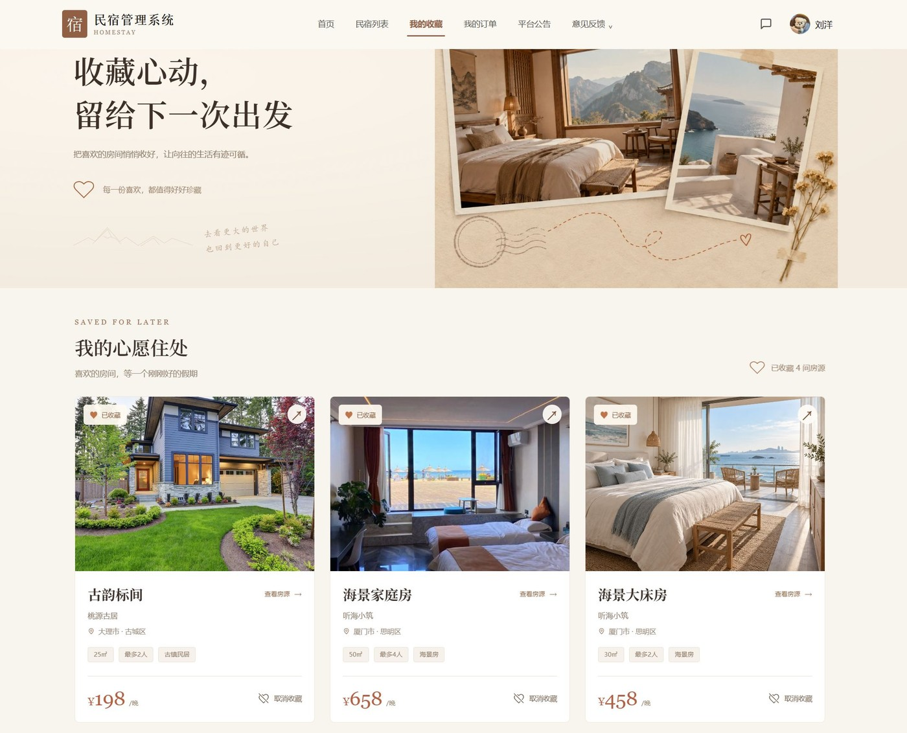 <b>我的收藏</b></td>
    <td width="50%" align="center"> <b>我的订单</b></td>
  </tr>
  <tr>
    <td width="50%" align="center">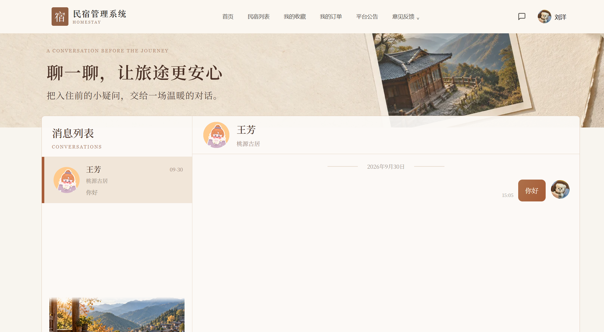 <b>在线聊天</b></td>
    <td width="50%" align="center"></td>
  </tr>
</table>

用户端其余页面：平台公告、意见反馈、我的反馈、我的投诉。

### 4.2 房东端

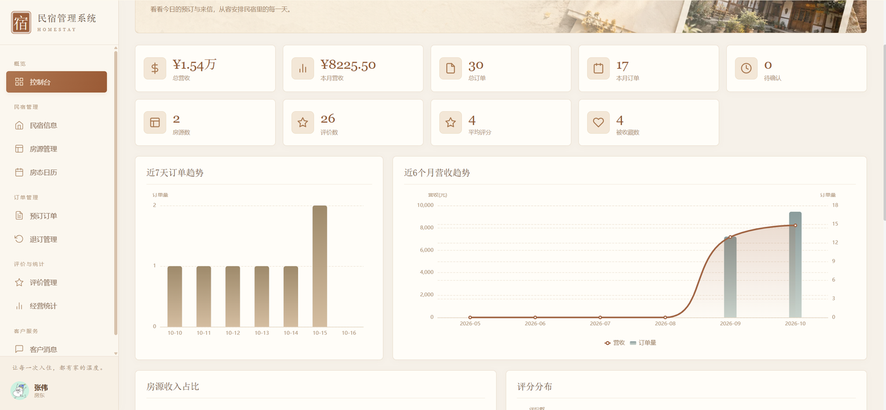

<b>数据分析</b>

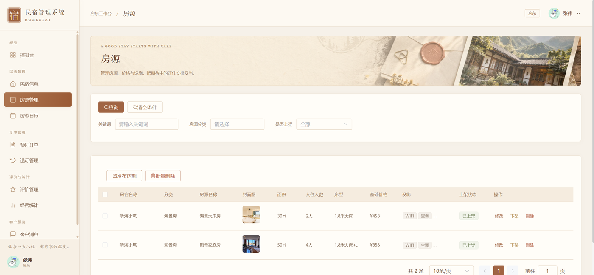

<b>房源管理</b>

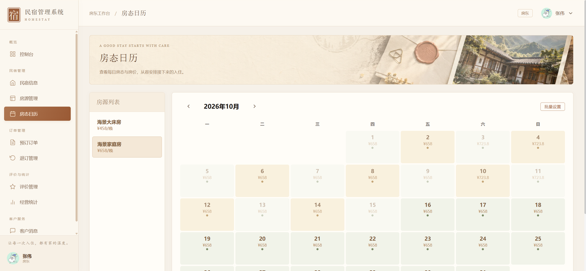

<b>房态日历</b>

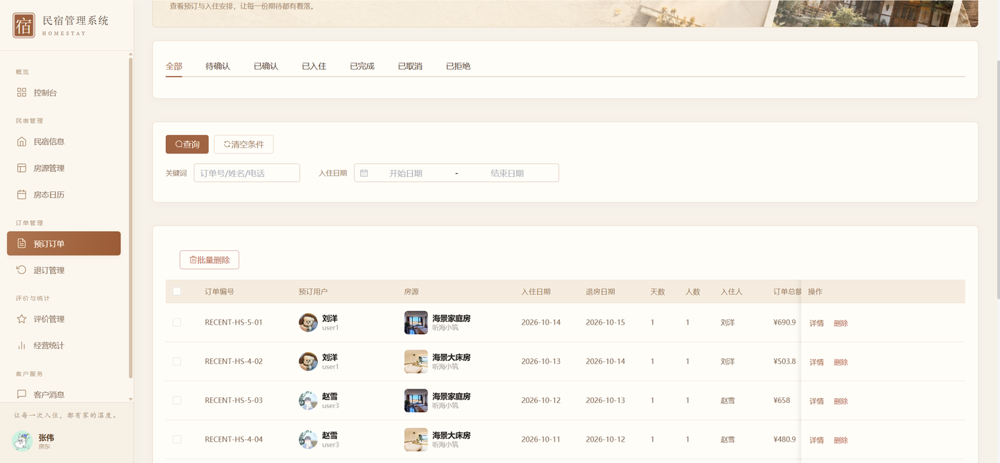

<b>预定订单</b>

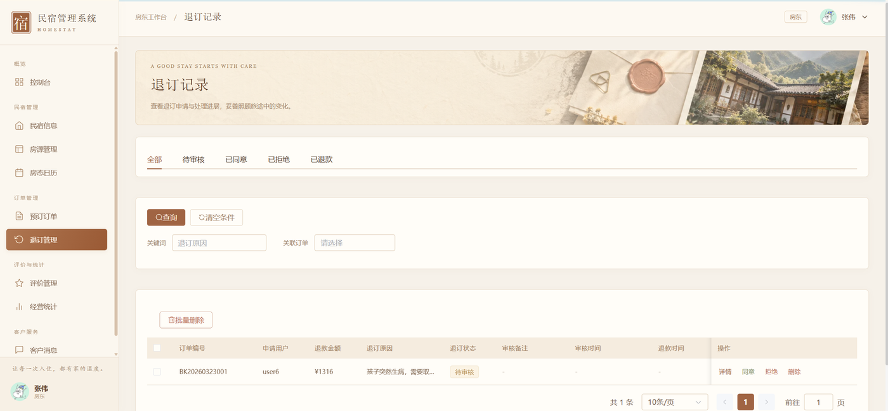

<b>退订管理</b>

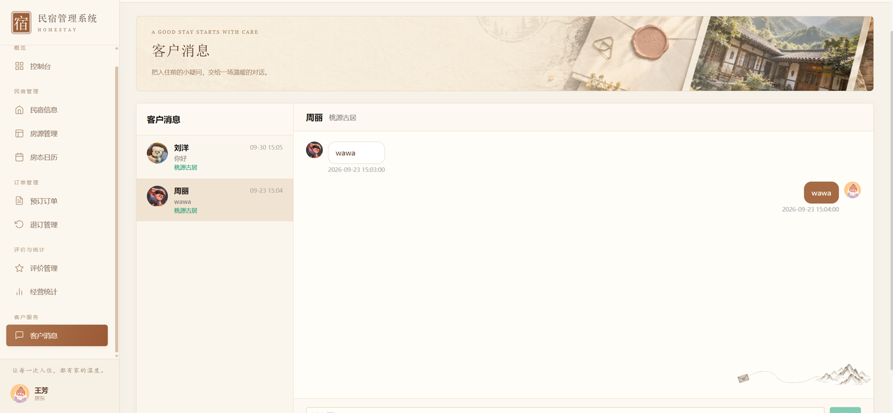

<b>客户聊天</b>

房东端其余页面：评价管理。

### 4.3 管理员端

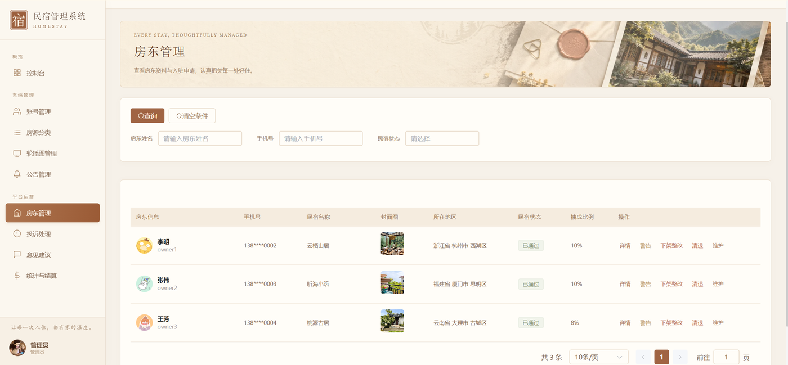

<b>房东管理</b>

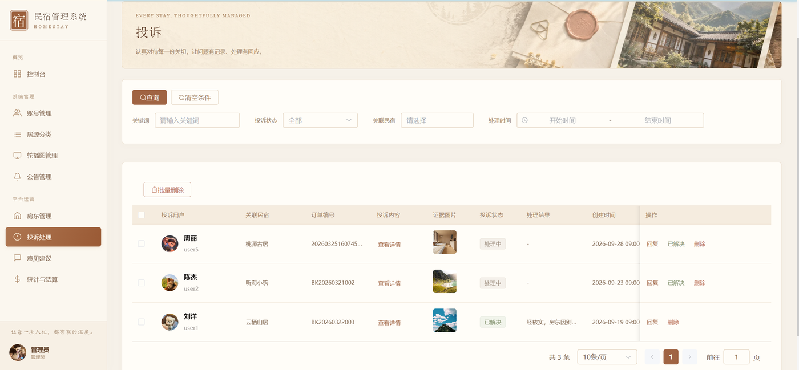

<b>投诉管理</b>

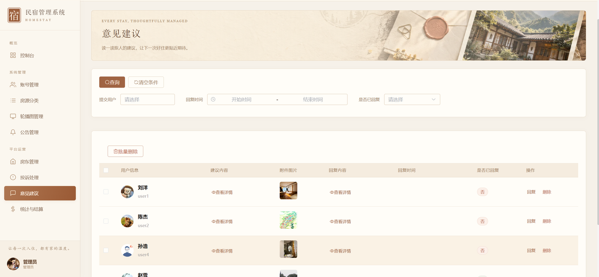

<b>意见建议</b>

管理员端其余页面：平台数据看板、用户账号管理、房源分类、首页轮播图、平台公告、经营统计与结算单。

---

## 五、关于本项目

本文档展示的是系统核心功能截图，完整源码、数据库脚本和部署说明不在仓库内展示。截图均存放于本地 `images/` 目录，不依赖外部图床。

如需了解完整功能、获取源码或定制开发，欢迎联系。

**文档展示 17 张截图，需要了解更多，请联系我。**
